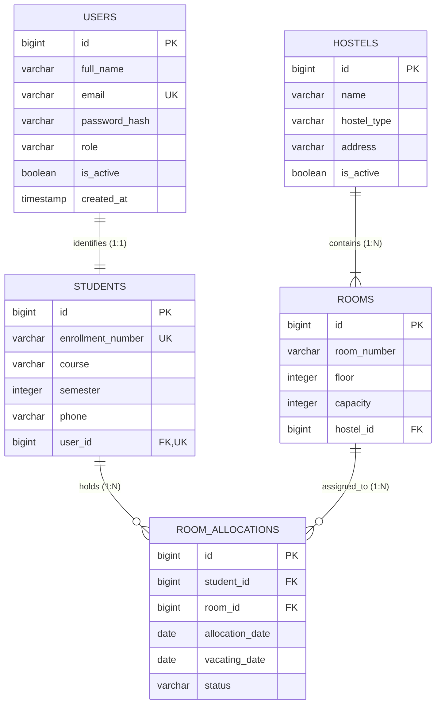

# HostelSync — Database Setup & Architecture Guide

## Overview

HostelSync is designed with a flexible data layer:
- **Phase 2A & 2B (Current)**: **H2 Database** configured in persistent **file-based mode** with core JPA entities implemented for Government Polytechnic Sakoli.
- **Subsequent Phases**: **PostgreSQL** (version 15 or 16) as the production-grade, ACID-compliant relational database management system.

---

## 1. Implemented Core Domain Model (Phase 2B)

The initial relational entity model is implemented using Spring Data JPA and Hibernate in `com.hostelsync.backend.entity`.



### Entity Specifications & Constraints

#### 1. `User` (`users` table)
- `id` (BIGINT, Primary Key, Identity generated)
- `fullName` (`full_name`, VARCHAR(100), NOT NULL)
- `email` (`email`, VARCHAR(150), NOT NULL, UNIQUE)
- `passwordHash` (`password_hash`, VARCHAR(255), NOT NULL, `@JsonIgnore`)
- `role` (`role`, VARCHAR(20), NOT NULL, Enum: `ADMIN`, `WARDEN`, `STUDENT`)
- `active` (`is_active`, BOOLEAN, NOT NULL, default: `true`)
- `createdAt` (`created_at`, TIMESTAMP, NOT NULL, set automatically on persist)

#### 2. `Student` (`students` table)
- `id` (BIGINT, Primary Key, Identity generated)
- `enrollmentNumber` (`enrollment_number`, VARCHAR(50), NOT NULL, UNIQUE)
- `course` (`course`, VARCHAR(100), NOT NULL)
- `semester` (`semester`, INTEGER, NOT NULL, range 1–10)
- `phone` (`phone`, VARCHAR(20), NOT NULL)
- `user` (`user_id`, BIGINT, NOT NULL, UNIQUE, `@OneToOne(fetch = FetchType.LAZY)`)

#### 3. `Hostel` (`hostels` table)
- `id` (BIGINT, Primary Key, Identity generated)
- `name` (`name`, VARCHAR(100), NOT NULL)
- `hostelType` (`hostel_type`, VARCHAR(20), NOT NULL, Enum: `BOYS`, `GIRLS`)
- `address` (`address`, VARCHAR(255), NOT NULL)
- `active` (`is_active`, BOOLEAN, NOT NULL, default: `true`)

#### 4. `Room` (`rooms` table)
- `id` (BIGINT, Primary Key, Identity generated)
- `roomNumber` (`room_number`, VARCHAR(20), NOT NULL)
- `floor` (`floor`, INTEGER, NOT NULL, min: 0)
- `capacity` (`capacity`, INTEGER, NOT NULL, min: 1)
- `hostel` (`hostel_id`, BIGINT, NOT NULL, `@ManyToOne(fetch = FetchType.LAZY)`)
- **Composite Unique Constraint**: `uk_hostel_room_number (hostel_id, room_number)` — prevents duplicate room numbers in the same hostel while permitting identical room numbers across different hostels.

#### 5. `RoomAllocation` (`room_allocations` table)
- `id` (BIGINT, Primary Key, Identity generated)
- `student` (`student_id`, BIGINT, NOT NULL, `@ManyToOne(fetch = FetchType.LAZY)`)
- `room` (`room_id`, BIGINT, NOT NULL, `@ManyToOne(fetch = FetchType.LAZY)`)
- `allocationDate` (`allocation_date`, DATE, NOT NULL)
- `vacatingDate` (`vacating_date`, DATE, NULLABLE)
- `status` (`status`, VARCHAR(20), NOT NULL, Enum: `ACTIVE`, `COMPLETED`)

---

## 2. Spring Data JPA Repositories

The persistence layer provides repositories with specialized query methods:
- **`UserRepository`**: `findByEmail`, `existsByEmail`, `findByRole`, `findByActiveTrue`
- **`StudentRepository`**: `findByEnrollmentNumber`, `existsByEnrollmentNumber`, `findByUserId`, `findByCourse`
- **`HostelRepository`**: `findByActiveTrue`, `findByHostelType`, `findByHostelTypeAndActiveTrue`
- **`RoomRepository`**: `findByHostelId`, `findByHostelIdAndFloor`, `findByHostelIdAndRoomNumber`, `existsByHostelIdAndRoomNumber`
- **`RoomAllocationRepository`**: `findByStudentId`, `findByRoomId`, `findByStatus`, `findByStudentIdAndStatus`, `countByRoomIdAndStatus`

---

## 3. Current Phase Limitations

To preserve strict separation of concerns and production readiness:
1. **No Authentication / Registration Endpoints**: Public user creation and authentication endpoints are not exposed yet. They are planned for Phase 2C with Spring Security and JWT.
2. **No Mock or Seed Data**: No fake student records, dummy users, or sample hostels are inserted on startup.
3. **No Direct Entity Exposure**: Entities will be shielded behind DTOs in future API controllers.
4. **Out of Scope for Phase 2B**: Gate passes, leave requests, maintenance complaints, and fee receipts will be implemented in subsequent phases.

---

## 4. Local Development with H2 (File-Based Mode)

H2 runs in **file-based persistent mode**, meaning database state persists across application restarts.

### Database File Location
- **Path**: `backend/data/hostelsyncdb.mv.db`
- **Git Status**: Excluded from version control via root `.gitignore`.

### H2 Web Console Access
| Setting | Value |
|---|---|
| **Console URL** | [http://localhost:8080/h2-console](http://localhost:8080/h2-console) |
| **Driver Class** | `org.h2.Driver` |
| **JDBC URL** | `jdbc:h2:file:./data/hostelsyncdb` |
| **User Name** | `sa` |
| **Password** | *(leave blank)* |

---

## 5. Future Migration to PostgreSQL

When migrating to PostgreSQL in production:

```powershell
$env:SPRING_DATASOURCE_URL = "jdbc:postgresql://localhost:5432/hostelsync"
$env:SPRING_DATASOURCE_DRIVER_CLASS_NAME = "org.postgresql.Driver"
$env:SPRING_DATASOURCE_USERNAME = "postgres"
$env:SPRING_DATASOURCE_PASSWORD = "YourSecurePasswordHere"
```
The JPA annotations and table/column specifications are fully compatible with PostgreSQL.
