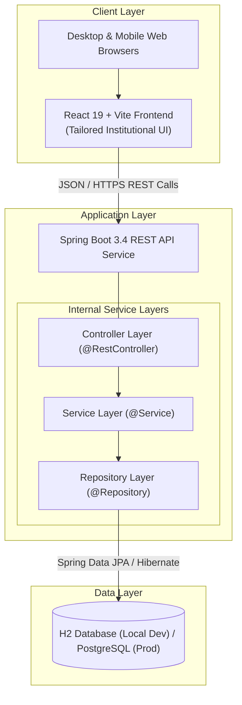
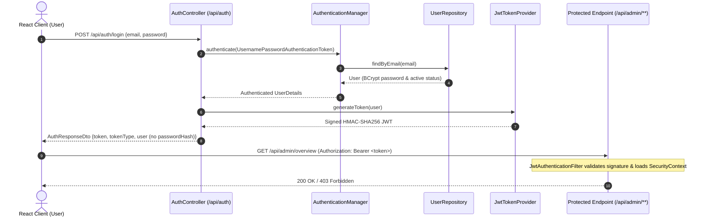

# HostelSync — Project Overview & Architecture Specification

## 1. Executive Summary

**HostelSync** is a modern, smart digital hostel management system custom-tailored for **Government Polytechnic Sakoli** (Bhandara District, Maharashtra). The platform digitizes and streamlines hostel operations—replacing error-prone manual paper registries with an integrated, secure, and role-governed digital ecosystem.

The system is engineered as a decoupled full-stack application comprising a high-performance **React.js + Vite** single-page frontend, a robust **Java 21 + Spring Boot** RESTful microservice backend, and an ACID-compliant relational persistence layer (**H2** in persistent file mode for local development, migrating to **PostgreSQL** in production).

---

## 2. Institutional Context & Objectives

**Institution**: Government Polytechnic Sakoli  
**Target Facilities**: Institute Boys Hostel and Girls Hostel blocks  
**Core Objectives**:
- **Transparency**: Clear, auditable room allocation and student occupancy tracking.
- **Operational Efficiency**: Paperless student leave/gate pass processing with automated timestamps.
- **Accountability**: Rapid tracking of maintenance complaints (electrical, plumbing, mess, security).
- **Safety**: Verified student records, emergency contact availability, and warden supervisory tools.

---

## 3. High-Level System Architecture

HostelSync follows a clean, decoupled 3-tier architecture with explicit separation of concerns:

### Architectural Principles:
1. **Stateless REST Communication**: Frontend and backend are decoupled. All data exchanges occur via standardized JSON payloads over HTTP/HTTPS.
2. **CORS & Proxy Separation**: During development, Vite proxies API requests to port `8080`.
3. **Twelve-Factor App Configuration**: Sensitive configurations (database credentials, server ports) are loaded strictly from environment variables.
4. **Defense in Depth**: Robust role-based access control (RBAC), DTO input validation with Jakarta Bean Validation (`@Valid`, `@NotNull`, `@Size`), and centralized exception handling.

---

## 4. Implemented Domain Model (Phase 2B)

The system implements the core relational entities with explicit table mappings and validation rules:

| Entity | Table | Core Fields | Constraints & Relationships |
|---|---|---|---|
| **`User`** | `users` | `id`, `full_name`, `email`, `password_hash`, `role`, `is_active`, `created_at` | `email` (UNIQUE), `role` (ADMIN, WARDEN, STUDENT) |
| **`Student`** | `students` | `id`, `enrollment_number`, `course`, `semester`, `phone`, `user_id` | `enrollment_number` (UNIQUE), `user_id` (1:1 with `users`) |
| **`Hostel`** | `hostels` | `id`, `name`, `hostel_type`, `address`, `is_active` | `hostel_type` (BOYS, GIRLS) |
| **`Room`** | `rooms` | `id`, `room_number`, `floor`, `capacity`, `hostel_id` | Composite UNIQUE `(hostel_id, room_number)`, N:1 with `hostels` |
| **`RoomAllocation`** | `room_allocations` | `id`, `student_id`, `room_id`, `allocation_date`, `vacating_date`, `status` | N:1 with `students`, N:1 with `rooms`, `status` (ACTIVE, COMPLETED) |

---

## 5. Security & Authentication Architecture (Phase 2C)

HostelSync enforces enterprise-grade stateless authentication and Role-Based Access Control (RBAC) across both backend services and the frontend client:

### Security Highlights:
1. **BCrypt Password Hashing**: Passwords are never stored or compared in plaintext; hashed with `BCryptPasswordEncoder` (10 rounds).
2. **Strict Password Hash Redaction**: Neither entities nor `passwordHash` are exposed over the wire. `UserSummaryDto` and `AuthResponseDto` encapsulate all identity transfers.
3. **Stateless JWT Lifecycle**: Signed via HMAC-SHA256 (`io.jsonwebtoken:jjwt:0.12.6`). Signing key and expiration duration are loaded from environment variables (`JWT_SECRET`, `JWT_EXPIRATION_MS`).
4. **Backend-Enforced Authorization**: Method security (`@PreAuthorize("hasRole('ADMIN')")`) and URL matchers enforce access controls independently of the frontend UI.
5. **Safe Admin Bootstrap Mechanism**: An `AdminBootstrapRunner` creates an initial administrator account only when explicitly enabled via `APP_BOOTSTRAP_ADMIN_ENABLED=true` alongside explicit credentials. No default or predictable passwords are created.
6. **Frontend Token Strategy**: The single-page application stores tokens in `sessionStorage` and in-memory React state. This bounds the token lifecycle to the active browser tab session, preventing persistent leakage on shared polytechnic laboratory terminals while surviving page refreshes.

---

## 6. Planned Application Roles & Permissions Matrix

HostelSync recognizes three primary user personas aligned with polytechnic administrative structures:

| Capability / Feature | Admin (Principal / In-Charge) | Warden | Student |
|---|:---:|:---:|:---:|
| **Hostel & Block Configuration** | Full Access | View Only | No Access |
| **Warden Assignment** | Full Access | No Access | No Access |
| **Room Master Setup** | Full Access | Edit/Update | View Available |
| **Student Admission & Allotment** | Approve / Audit | Assign / Reallocate | Submit Request |
| **Gate Pass / Leave Approval** | Global View | Review / Approve / Reject | Create Request |
| **Maintenance Grievances** | Escalation Monitoring | Assign & Resolve | File & Track Status |
| **Fee Receipt Verification** | Audit & Reports | Verify Payment | Upload Receipt |
| **Mess Feedback & Notices** | Broadcast | Broadcast & Inspect | Submit Feedback / Read |
| **Audit Logs & System Reports** | Full Access | Operational Reports | Personal History |

---

## 7. Technology Stack Summary

| Layer | Technology | Version | Purpose |
|---|---|---|---|
| **Frontend Framework** | React.js | 19.x | Component-driven reactive user interface |
| **Frontend Routing** | React Router DOM | 7.x | Client-side routing with `ProtectedRoute` guards |
| **Frontend Tooling** | Vite | 6.x / 8.x | Lightning-fast HMR and optimized bundler |
| **Frontend Styling** | Vanilla CSS3 | Standard | Custom design system with institutional blue & gold accents |
| **Backend Framework** | Spring Boot | 3.4.3 | Enterprise RESTful API services |
| **Security Framework** | Spring Security | 6.4.x | Stateless JWT filter chain, BCrypt, RBAC |
| **JWT Library** | JJWT (io.jsonwebtoken) | 0.12.6 | Cryptographic JWT signing and validation |
| **Runtime Language** | Java (JDK) | 21 (LTS) | Modern Java features (records, virtual threads) |
| **Build & Dependency Tool** | Apache Maven | 3.9.x | Reproducible builds via Maven Wrapper |
| **ORM & Persistence** | Spring Data JPA / Hibernate | 6.6.x | Relational mapping, repositories, and transaction management |
| **Local Database** | H2 Database | 2.3.x | Persistent file-based local database with web console |
| **Production Database** | PostgreSQL | 15 / 16 | ACID-compliant relational storage for staging/production |

---

## 8. Implementation Roadmap & Current Status

- **Phase 1 (Complete)**: Project foundation setup, directory structure, Vite React welcome portal, Spring Boot skeleton with `GET /api/health`, and documentation.
- **Phase 2A (Complete)**: Local development database setup with H2 file-based persistence and H2 web console.
- **Phase 2B (Complete)**: Core database domain model (`User`, `Student`, `Hostel`, `Room`, `RoomAllocation`), Spring Data JPA repositories, constraint enforcement, and integration tests.
- **Phase 2C (Complete)**: Secure authentication (Spring Security 6, JJWT 0.12.6, BCrypt, opt-in admin bootstrap, RBAC on endpoints, responsive React login portal, and protected routes).
- **Phase 3A (Complete)**: Admin Dashboard and Hostel/Room Management (Database-backed Hostels CRUD & active status toggle, Rooms CRUD with capacity and floor validation, room number uniqueness per hostel, allocation conflict protection, and responsive executive Admin portal).
- **Phase 3B (Complete)**: Student Directory & Basic Admission Record Management (DTO-based REST endpoints under `/api/admin/students`, linked User accounts with `Role.STUDENT`, unique enrollment numbers & institutional emails, BCrypt password hashing, allocation-safe deletion protection returning 409 Conflict, and responsive Admin Portal Student Directory tab with live search, filters, detail modals, and create/edit forms).
  - *Architectural Note on Admissions Model*: The existing `Student` entity (linked 1:1 with `User` and 1:N with `RoomAllocation`) comprehensively captures student identity, admission enrollment details, department/semester standing, and residential history without creating a redundant `Admission` entity that would duplicate student identity data.
- **Phase 3C / Phase 4**: Room allocation assignment workflow, digital gate pass system, grievance/complaint ticketing, and fee verification.
- **Phase 5**: Admin reporting, exportable PDF/Excel rosters, and institutional notification broadcast.

